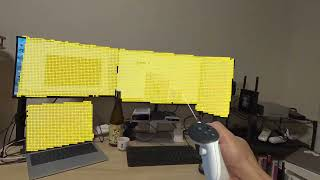

# Spatial-Search-Lite

English | [日本語](README_JP.md)

**A spatial search app for Meta Quest that finds objects in front of you using words or gestures.**

Type `monitor` or `chair`, and the location of what it finds is highlighted as a point cloud. There are also scenes where you can grab and move what was found, or cut out an object and copy it using a frame made with the fingers of both hands.

| What you can try | Demo video |
|---|---|
| Highlight an object found by a word | [](https://youtu.be/CpNNvYJ_eqo)<br>[▶ YouTube](https://youtu.be/CpNNvYJ_eqo) |
| Grab and move an object found by a word | [](https://youtu.be/KBflmsotNTc)<br>[▶ YouTube](https://youtu.be/KBflmsotNTc) |
| Copy an object with a frame made by your fingers (experimental) | [](https://youtu.be/BAKXGBKgiSI)<br>[▶ YouTube](https://youtu.be/BAKXGBKgiSI) |

**You need a Meta Quest 3 / 3S and a PC that does the AI processing.** In these steps, you get the repository onto your PC, build the app in Unity, and install it on the Quest.

- [Requirements](#requirements)
- [First-time setup](#first-time-setup)
- [Start up and search](#start-up-and-search) (from the second time on, start here)
- [Troubleshooting](#troubleshooting)

## Requirements

| What you need | Purpose / conditions |
|---|---|
| Meta Quest 3 / 3S and controllers | Uses the passthrough camera and depth |
| PC | An environment that can run SAM 3.1 in ComfyUI. Python 3.10 or later is also required |
| [ComfyUI](https://www.comfy.org/) and the SAM 3.1 model | Finds objects in the camera image. Prepare the model with the steps below |
| Unity 6000.3.7f1 | For building the app. Install Android Build Support (including the SDK, NDK, and OpenJDK) |
| USB cable | Used to install the built app from the PC onto the Quest |
| Connection to the same LAN | Connect the Quest and the PC running the Python server to the same network |

The Quest's camera image is sent to the PC, and the result of object recognition on the PC is shown on the Quest. **While you are using the app, keep ComfyUI and the Python server running on the PC.**

## First-time setup

### 1. Get the repository onto your PC

If you use Git, run the following commands.

```bash
git clone https://github.com/TakashiYoshinaga/Spatial-Search-Lite.git
cd Spatial-Search-Lite
```

If you don't use Git, download from **Code → Download ZIP** on this page and extract it.

**Run the Python commands below in the folder that contains `README.md`.** If you used the ZIP, open the extracted folder in a terminal.

### 2. Prepare the AI environment on the PC

#### Prepare ComfyUI and the model

1. Install [ComfyUI](https://www.comfy.org/). If you already use it, update it to the latest version. The server needs nodes such as `SAM3_Detect`.
2. [Download `sam3.1_multiplex_fp16.safetensors`](https://huggingface.co/Comfy-Org/sam3.1/blob/main/checkpoints/sam3.1_multiplex_fp16.safetensors) and place it in ComfyUI's `models/checkpoints/` **without renaming the file**.

The model goes here:

```text
ComfyUI/
└── models/
    └── checkpoints/
        └── sam3.1_multiplex_fp16.safetensors
```

- **Portable / git clone version:** place it in `models/checkpoints/` inside the ComfyUI folder.
- **ComfyUI Desktop:** open **Menu → Desktop Settings → Storage** and check the model folder location under **Shared Models**.

After placing the model, restart ComfyUI if it is running.

#### Prepare the Python server

At the repository root, install the Python server's dependencies.

```bash
python -m pip install -r server/requirements.txt
```

### 3. Build the Quest app and install it

1. Put the Quest in developer mode and connect it to the PC with USB. When the Quest asks you to **allow USB debugging**, allow it. If this is your first time setting up, see [Meta's official headset setup guide](https://developers.meta.com/vr/documentation/unity/unity-env-device-setup/).
2. From Unity Hub, open this repository's **`UnityMetaQuest` folder** with Unity 6000.3.7f1.
3. First, open **`Assets/Scenes/0-SpatialSearchLite.unity`**.
4. Open **File → Build Profiles**, select the Android profile, and activate it. If there is no profile, create one with **Add Build Profile → Android** and press **Switch Profile**.
5. Add the open scene to the **Scene List** and **check only the scene you want to try**.
6. Select the connected Quest in **Run Device** and run **Build And Run**. Once you specify a save location, the app is installed on the Quest after the build and launches.

For details on the build window, see [Unity's official Android build guide](https://docs.unity.com/en-us/engine/6000.3/manual/platform-specific/android/building-and-delivering/build-process).

To try the other experiences, switch to one of the following scenes and build again. All scenes are in `UnityMetaQuest/Assets/Scenes/`.

| Scene file | What you can try |
|---|---|
| `0-SpatialSearchLite.unity` | Shows an object found by a word as a single-color point cloud (the scene to try first) |
| `1-SpatialSearchLiteGrab.unity` | Shows found objects with the camera image on them, and lets you grab and move them with the controllers |
| `2-SpatialSearchLiteFrame(Experimental).unity` | Copies an object with a finger frame. You can also search by word, and grab the results with your hands |

## Start up and search

Once the first-time setup is done, start in this order: **ComfyUI → Python server → Quest app**. The steps are the same from the second time on.

### 1. Start ComfyUI and the Python server

Start ComfyUI as usual. The workflow is run from the server, so you don't need to do anything on ComfyUI's screen.

Next, start the Python server at the repository root.

```bash
python server/server.py --host 0.0.0.0
```

When `listening on ws://0.0.0.0:8765/` is shown, the server is ready to accept connections from the Quest. Keep this terminal open. Press `Ctrl+C` to quit.

ComfyUI's port can differ depending on the version and settings. Check `To see the GUI go to: http://…:port` in its startup log, and if it differs from `http://127.0.0.1:8188`, specify `--comfyui` from the [server options](docs/development.md#server-options) (e.g. `--comfyui http://127.0.0.1:8000`). Even if the address in the log shows `0.0.0.0`, specify `127.0.0.1` here.

> The server has no authentication or encryption. Use it only inside a trusted LAN.

### 2. Connect from the Quest app to the PC

1. Launch the Quest app. If it is already running right after the first build, just continue.
2. When asked for access to **spatial data** and the **camera**, allow both.
3. In **Server IP address**, enter the LAN IP address of the PC running the Python server, and press **Connect**.

On Windows, run `ipconfig` in a terminal on the PC and check the **IPv4 address** of the Wi-Fi / Ethernet adapter connected to the same network as the Quest. For example, `192.168.1.10`. `0.0.0.0` is the value the server listens on, so enter the PC's IP address in this field.

**When the dialog closes, you are connected.** The IP address you entered is saved and is already filled in next time.

### 3. Search for what is in front of you

1. Press **Search** on the left controller's panel with the right hand's ray.
2. In the search window that opens, type the name of the object **in English**. Try `monitor`, `chair`, `cup`, and so on first.
3. Face the object you want to find and press **Search** in the window. The window closes automatically.
4. When the result comes back, the location of what was found is highlighted. The left controller's panel shows the search status and the number of objects found.

In the basic scene, a yellow point cloud is shown. In the Grab / Frame scenes, objects are shown with the captured camera image on them. Searching for something else clears the previous result.

To grab and move objects, or to copy with a finger frame, go to [the instructions for the additional features](docs/interactions.md).

## Troubleshooting

| Symptom | What to check |
|---|---|
| The dialog does not close after pressing **Connect** / `Not connected to the server` is shown | Check that the Quest and PC are on the same LAN, that the PC's IP address is correct, and that you started the server with `--host 0.0.0.0`. Also check that the PC's firewall allows connections to port 8765. If the connection is lost, restart the app |
| The server shows an error such as `could not reach` | Check that ComfyUI is running and that the `--comfyui` URL is correct |
| `ComfyUI execution failed` is shown | Update ComfyUI, and check the model's file name and location (`models/checkpoints/`) |
| `was not found` is shown | Change the search term to a common English name, or try again closer to the object. If needed, lower [the server's `--threshold`](docs/development.md#server-options) |
| The points appear offset | The point cloud is built from the position at the moment of capture. Try not to move your head much when you press Search |

For problems with grabbing and the finger frame, see ["Troubleshooting" in the additional features](docs/interactions.md#troubleshooting).

## Learn more

- [Grab and copy with a finger frame](docs/interactions.md): how to use the Grab / Frame scenes
- [Settings and how it works](docs/development.md): server options, Unity settings, and an explanation of the implementation
- [SpatialSearch package](Packages/SpatialSearch/README.md): how to use it in another Unity project

## License

This repository is under the [MIT License](LICENSE). The SAM 3.1 model is distributed at [Comfy-Org/sam3.1](https://huggingface.co/Comfy-Org/sam3.1) and the SAM License applies to it.

## Support

If you find this project useful, you can support me via PayPal:  
[](https://paypal.me/TakashiYoshinaga)  
